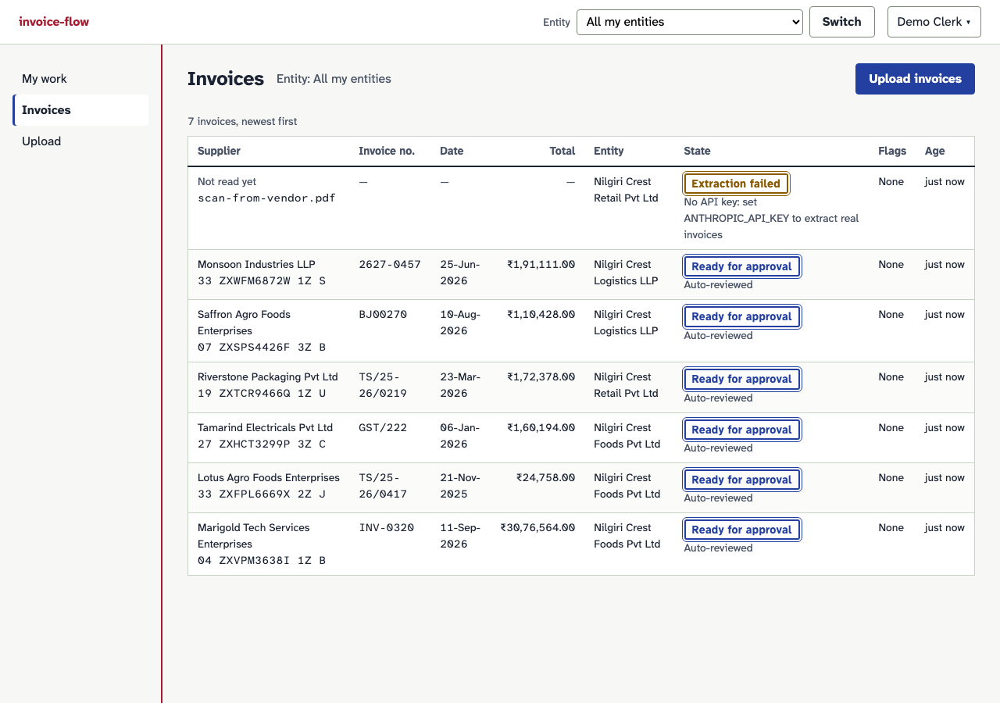
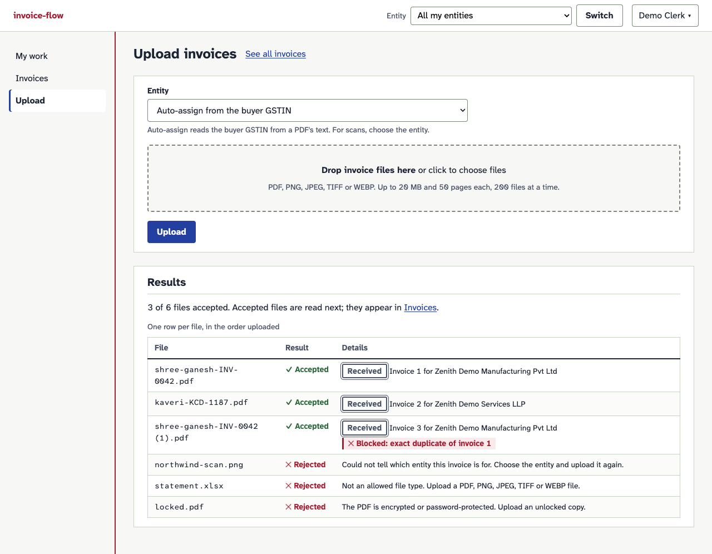
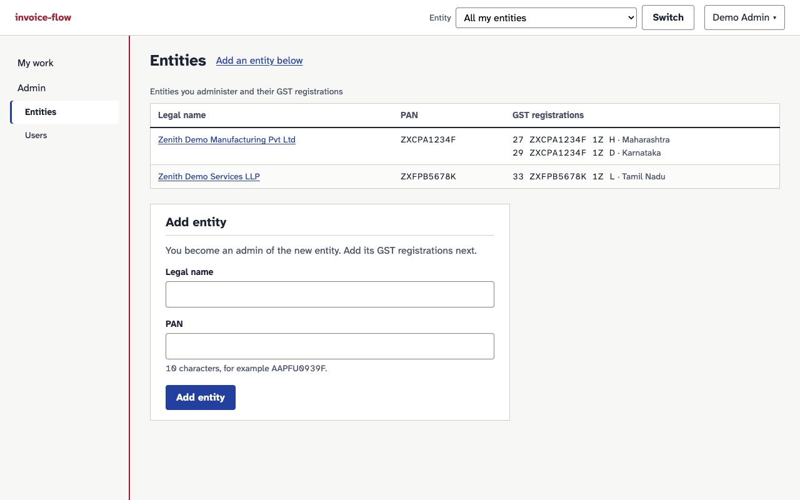

# invoice-flow

Accounts-payable invoice processing for Indian companies that run several legal entities.
Invoices come in, Claude reads them, GST and duplicate checks run automatically, a clerk
confirms what needs a human eye, approvers sign off by amount, and accounting gets a clean
export. Every step is permission-checked per entity and written to a tamper-evident audit trail.



> **Status: being built.** The upload → extraction part of the workflow works today; review,
> approval and export are the next slices (see [Progress](#progress)). All data in this repo
> is synthetic.

This repository is also a worked example of building software the **AI-native way**: every
change traces back to a committed intent, spec and plan, and most of the code was written
by headless Claude Code sessions picking up GitHub Issues, with a human approving each step.
See [How this repo is built](#how-this-repo-is-built).

---

## Contents
- [What it does](#what-it-does)
- [Progress](#progress)
- [Quick start](#quick-start)
- [Trying the workflow](#trying-the-workflow)
- [Configuration](#configuration)
- [Architecture](#architecture)
- [Security and data protection](#security-and-data-protection)
- [Development](#development)
- [How this repo is built](#how-this-repo-is-built)
- [Documents](#documents)

## What it does

| Capability | Details |
|---|---|
| **Multi-entity** | One install serves several legal entities (each with a PAN and GST registrations in one or more states). Users get roles per entity; another entity's records are invisible (404, not 403). |
| **Intake** | Drag-and-drop upload of many files at once (PDF, PNG, JPEG, TIFF, WEBP; 20 MB and 50 pages each). File type is checked from the bytes, not the name. Email inbox and watched-folder intake are planned. |
| **AI extraction** | Claude (`claude-opus-5-5`, structured output) reads each invoice into a fixed schema: supplier and buyer, invoice number and date, line items, tax summary, IRN. Each field gets a confidence of high, medium or low, lowered by deterministic checks. Without an API key a **demo extractor** returns the known answers for the bundled sample invoices, so the app runs offline. |
| **GST validation** | GSTIN format and check character, CGST+SGST/UTGST vs IGST by place of supply, rate table with effective dates (including the 22-Sep-2025 slabs), arithmetic within ₹1, HSN/SAC, IRN format, Rule 46 mandatory fields. Behind a pluggable `TaxRegime` interface. |
| **Duplicate detection** | Exact (same supplier GSTIN + normalised number + financial year, or same file) blocks; near matches (number one character apart, or total within 1% and dated within 30 days) warn. The agreed tighter rule, with the 30-day window on both, is issue #29. |
| **Touch-free path** | An invoice whose fields are all high-confidence with no flags skips review and goes straight to approval, marked *auto-reviewed*. |
| **Review** *(next)* | The document beside the fields, low-confidence fields first, flags that say what is wrong and how to fix it. |
| **Approval** *(planned)* | Amount-based tiers per entity, separation of duties enforced on the server (an uploader, editor or admin cannot approve), works on a phone. |
| **Export** *(planned)* | CSV and JSON in a documented format, export batches, mark paid. |
| **Audit** | Every state change and admin action writes an append-only, hash-chained event in the same transaction. `make verify-audit` detects tampering. |

**Roles:** clerk (uploads and reviews), approver (by tier), accountant (exports, marks paid),
admin (entities, users, configuration; cannot approve), auditor (read-only, verifies the chain).

## Progress

The build follows a **walking skeleton**: one thin path through the whole journey first,
then depth. Tracked in [plan.md](intent/0001-invoice-processing/plan.md) and GitHub Issues.

| Step | Slice | State |
|---|---|---|
| Foundations | Money, invoice state machine, audit chain (S1); GST library (S2); duplicate library (S3); synthetic invoices (S4) | ✅ merged |
| Accounts | Login, users, entities, GST registrations, per-entity roles (S5); visual design applied (S5.1) | ✅ merged |
| 1. Upload | Upload screen and invoice list (S7) | ✅ merged |
| 2. Extract | Claude extraction + demo mode, validation flags, touch-free path (S9) | ✅ merged |
| 3. Review | Review screen, duplicate compare, invoice history (S11) | ⏳ next |
| 4. Approve | Approval inbox and phone approve screen, default tier (S12) | planned |
| 5. Export | CSV/JSON export, mark paid (S13) | planned |
| Depth | Tier admin (S6), vendors and bank details (S8), auth hardening (S5.2), extraction eval (S10), email and folder intake (S14), dashboard and audit search (S15) | planned |

## Quick start

Needs **Python 3.13+** and **[uv](https://docs.astral.sh/uv/)**. No other services: the
database is a SQLite file and the job worker runs inside the app.

```sh
git clone https://github.com/sandeepkhokher/invoice-flow.git
cd invoice-flow
make setup          # install dependencies
make gen-invoices   # ~60 synthetic sample invoices + ground truth in evals/data/
make seed-demo      # demo entities and one user per role; prints the passwords
make run            # http://127.0.0.1:8000
```

Sign in with one of the users `make seed-demo` printed (for example `clerk@demo.example`).
Passwords are generated on every run; set `INVOICE_FLOW_DEMO_PASSWORD` to fix them.
The database is created and migrated on start.

To read real invoices, set an API key before `make run`:
```sh
export ANTHROPIC_API_KEY=sk-ant-...   # never commit it; .env is git-ignored
```

## Trying the workflow

1. Sign in as **clerk@demo.example** and open **Upload**.
2. Drag in a few files from `evals/data/` (for example `inv-001.pdf`, `inv-005.pdf`).
   Leave *Auto-assign* on for PDFs; for scanned images (`.png`) choose the entity.
3. Open **Invoices**: each goes *Received → Extracting →* either *Ready for approval
   (auto-reviewed)* or *Needs review* when a check raised a flag. Try a sample with a seeded
   error (see `evals/data/manifest.json`, `seeded_error`) or upload the same file twice to
   see a duplicate block.
4. Sign in as **admin@demo.example** to see **Admin → Entities** and **Users**.

| Upload with per-file results | Admin: entities |
|---|---|
|  |  |

## Configuration

All settings are environment variables with the prefix `INVOICE_FLOW_` (or a `.env` file);
see [`app/config.py`](app/config.py).

| Variable | Default | Purpose |
|---|---|---|
| `ANTHROPIC_API_KEY` | unset | Claude API key. Unset = demo extractor (sample invoices only) |
| `INVOICE_FLOW_DATA_DIR` | `data` | SQLite database and uploaded files (`files/`, owner-only permissions) |
| `INVOICE_FLOW_EXTRACTION_MODEL` | `claude-opus-5-5` | Model used for extraction |
| `INVOICE_FLOW_EXTRACTION_EFFORT` | `medium` | `low` … `max`; tuned by the extraction eval |
| `INVOICE_FLOW_WORKER_THREADS` | `4` | In-process job worker threads (`0` turns the worker off) |
| `INVOICE_FLOW_MAX_UPLOAD_BYTES` | 20 MB | Per-file limit; also `MAX_PAGES` (50), `MAX_FILES_PER_UPLOAD` (200) |
| `INVOICE_FLOW_SESSION_IDLE_MINUTES` | `30` | Sign-in session idle timeout |
| `INVOICE_FLOW_LOGIN_MAX_FAILURES` | `5` | Failed sign-ins before a 15-minute lockout |
| `INVOICE_FLOW_AUTO_MIGRATE` | `true` | Apply database migrations on start |
| `INVOICE_FLOW_DEMO_PASSWORD` | unset | Fixed password for `make seed-demo` users |

## Architecture

```
 browser (Jinja + HTMX, one stylesheet)
        │
 FastAPI app ── auth, CSRF, entity scoping (app/api, app/scoping.py)
        │
        ├── intake: file checks, file store, SHA-256      app/intake
        ├── jobs table + in-process worker                  app/jobs.py, app/worker.py
        │       └── extraction: Claude or demo extractor   app/extraction
        │               └── validation: GST + duplicates    app/tax, app/duplicates.py
        ├── transitions: the only code that changes an      app/domain/transitions.py
        │   invoice's state; checks role and writes audit
        └── audit: append-only, hash-chained events         app/audit
        │
 SQLite (WAL) via SQLAlchemy 2 + Alembic migrations
```

- **Server-rendered**, no JavaScript framework or build step; HTMX for partial updates;
  fonts and scripts served from the app (no third-party requests).
- **Money** is integer paise in the database and `Decimal` in Python, never `float`.
- **Invoice states:** received → extracting → needs review / ready for approval →
  in approval → approved → exported → paid; plus extraction failed, rejected, discarded.
- **Sized for** about 2,000 invoices a month per install; one process, one SQLite file.

```
app/          application code (see above); templates/ and static/ for the UI
alembic/      database migrations, one per database slice
evals/        synthetic invoice generator and (soon) the extraction eval
intent/       intent, spec, screens, visual design and plan for each body of work
doc/          method notes and the design style guide (doc/design/styleguide.html)
scripts/      ticket_runner.py: builds GitHub Issues with headless Claude Code
tests/        pytest suite; the Claude API is always mocked
.claude/      Claude Code project setup: policy skills, hooks, verifier agent, runner prompt
```

## Security and data protection

- Passwords hashed with Argon2id; server-side sessions (HttpOnly, SameSite=Lax), 30-minute
  idle timeout, account lockout; CSRF tokens on every state-changing request.
- Every route except `/login`, `/health` and static assets requires sign-in; entity scoping
  in one place; other entities' records return 404.
- Invoice text is treated as **untrusted**: the model's output only fills the extraction
  schema and never decides an invoice's state or flags. Logs carry token counts and timing,
  never document content.
- Bank details are masked in storage and on screen (encrypted storage and audited reveal
  arrive with vendors, S8). Uploaded files live outside any served directory.
- The policies the code must follow are written down as Claude Code skills in
  [`.claude/skills/`](.claude/skills) (`data-protection`, `approval-and-audit`,
  `gst-invoice-rules`, `ux-standards`).
- Known open items are tracked as issues (for example auth hardening in #38).

## Development

| Command | What it does |
|---|---|
| `make test` | Full test suite (about 900 tests; no API key or network needed) |
| `make lint` | Ruff lint and format check, as CI runs it |
| `make fmt` | Auto-format and fix lint |
| `make migrate` | Apply migrations to the database under `INVOICE_FLOW_DATA_DIR` |
| `make verify-audit` | Verify the audit hash chain; non-zero exit if anything was tampered with |
| `make gen-invoices` | Regenerate the synthetic invoice set (deterministic for the seed) |
| `uv run pytest tests/test_upload.py -k duplicate` | Run a subset |

CI (GitHub Actions) runs lint and tests on every pull request. Conventions for humans and
Claude alike are in [`CLAUDE.md`](CLAUDE.md): money never as float, every state change
through `transitions.py`, every query through the entity scope, fix code not tests.

## How this repo is built

The project follows Anthropic's *AI-Native SDLC Playbook*. Each stage commits one artifact
that the next stage reads, and a human approves each one by merging its pull request.

| Stage | Artifact | Gate |
|---|---|---|
| 1 Plan | [`intent.md`](intent/0001-invoice-processing/intent.md): the problem, users, scope, success measures | Product owner merges |
| 2 Design | [`spec.md`](intent/0001-invoice-processing/spec.md) (FR-n requirements, design, concerns), policy skills, [`screens.md`](intent/0001-invoice-processing/screens.md), [`visual-design.md`](intent/0001-invoice-processing/visual-design.md) | Product owner merges |
| 3 Build | [`plan.md`](intent/0001-invoice-processing/plan.md) cut into slices; one GitHub Issue per slice | Engineer accepts the plan |
| 4 Test | Tests and evals; output pasted into each PR | Checks green |
| 5 Deploy | Pull request with review findings | Human merges |
| 6 Maintain | Monitoring that writes new intents | Triage |

**The ticket runner.** Labelling an issue `agent:ready` releases it. `make runner` picks it
up, creates a git worktree from `main`, runs a headless Claude Code session with the
project's rules, skills and guardrail hooks, re-runs lint and tests itself, and opens a pull
request (or labels the issue `agent:blocked` with the reason). A separate Claude review
checks the riskier PRs against their acceptance criteria before a human merges.

Guardrails in [`.claude/`](.claude): hooks block edits to approved artifacts and policies,
secrets in files, reads of `.env`, pushes to `main` and PR merges by agents.

More on the method: [`doc/starting-a-new-project.md`](doc/starting-a-new-project.md) and
[`doc/scrum-to-ai-native-mapping.md`](doc/scrum-to-ai-native-mapping.md).

## Documents

| Document | Purpose |
|---|---|
| [intent.md](intent/0001-invoice-processing/intent.md) | Why this exists and how success is measured |
| [spec.md](intent/0001-invoice-processing/spec.md) | Requirements (FR-1 … FR-65), design, decisions and concerns |
| [screens.md](intent/0001-invoice-processing/screens.md) | Every screen, who sees it, layouts |
| [visual-design.md](intent/0001-invoice-processing/visual-design.md) | The look; style guide at `doc/design/styleguide.html` |
| [plan.md](intent/0001-invoice-processing/plan.md) | Slices, order, risks and recorded departures |
| [CLAUDE.md](CLAUDE.md) | Commands and conventions for contributors and Claude Code |

No licence has been chosen yet; until one is added, all rights are reserved by the author.
